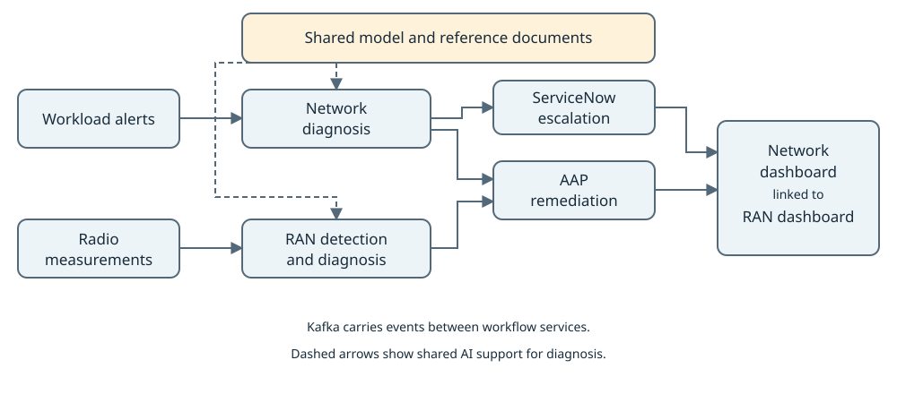

# Automate Network and RAN Incident Response with AI

Investigate infrastructure failures and radio anomalies, run remediation playbooks, and track incident outcomes in connected dashboards.

[](LICENSE)

## Description

Network operations teams need to investigate infrastructure failures and degraded radio service. This quickstart provides two workflows: **Network** investigates OpenShift workload alerts, while **RAN** (radio access network) detects unusual radio performance measurements. Both combine incident evidence with reference documents to explain likely causes and proposed actions.

Operators can follow diagnosis and remediation in separate, linked dashboards, reducing the need to gather evidence across tools. Ansible Automation Platform (AAP) executes configured playbooks, and ServiceNow records Network incidents that need escalation.

This guide covers deployment with real integrations. For contributing, local development, simulated incidents, and mock services, use the [contributor guide](CONTRIBUTING.md). **Mocks and automation bypasses are for development only.**

### Architecture



*Workload alerts and radio measurements feed separate workflows. Shared AI services support diagnosis; AAP runs remediation, ServiceNow handles Network escalation, and dashboards show outcomes.*

See the [architecture guide](docs/architecture.md) for deployment topology and service details.

## Requirements

### Minimum Hardware Requirements

The existing Network sizing baseline is listed below. A combined Network/RAN minimum has not been established; reserve additional capacity for RAN services and any locally hosted predictor.

- **CPU:** 8+ vCPU cores for Network.
- **Memory:** 32+ GB RAM for Network.
- **Storage:** 100+ GB with dynamic volume provisioning. The bundled Kafka uses the `gp3-csi` storage class by default.
- **GPU:** One NVIDIA A10G, A100, L40S, or equivalent for local Granite model serving. An external model endpoint avoids this local GPU requirement.
- **Network:** Access from hub pods to container registries, Helm chart repositories, model endpoints, AAP, and ServiceNow.

### Minimum Software Requirements

These are documented prerequisites. Exact tested versions and a combined Network/RAN sizing profile have not been recorded.

| Requirement | Purpose |
| --- | --- |
| OpenShift 4.21+ and OpenShift AI 3.4+ | Application and AI platform; aligned with the topology guide |
| Llama Stack operator with `LlamaStackDistribution` available | Model access and document retrieval |
| `oc` matching the cluster, Helm 3+, GNU Make, Git, Bash, Python 3 | Deployment tools |
| OpenAI-compatible language-model endpoint and credentials | Network and RAN diagnosis and chat |
| RAN predictor accepting `POST /v1/detect` | Anomaly detection; see the [predictor guide](model-serving/ran-ml-service/README.md) |
| AAP 2.5+, its operator, and a configured controller | Playbook execution |
| Ansible Lightspeed enabled in AAP | Generate remediation playbooks |
| ServiceNow instance and an integration account with incident access | Network escalation and incident updates |

Provide workload logs through OpenShift Logging and a producer for RAN measurements. The [operational input setup](docs/integration-setup.md#operational-inputs) covers logging prerequisites, Kafka client certificates, and the measurement format.

Use **cluster-admin** or equivalent permissions for operator installation and cluster-scoped access rules.

**Set up AAP on the hub cluster:** Follow the [AAP installation guide for OpenShift](https://docs.redhat.com/en/documentation/red_hat_ansible_automation_platform/2.5/html-single/installing_on_openshift_container_platform/index) to install the operator and deploy the platform. Enable the controller in the `AnsibleAutomationPlatform` resource with `spec.controller.disabled: false`.

**Create an AAP token:** Follow **Adding tokens** in the [AAP authentication guide](https://docs.redhat.com/en/documentation/red_hat_ansible_automation_platform/2.5/html/access_management_and_authentication/gw-token-based-authentication). Create a personal access token with **Write** scope, copy its value when shown, and set `AAP_TOKEN` in `.env`.

Complete the [integration setup guide](docs/integration-setup.md) to prepare the AAP project, `lightspeed-runner` template, target-cluster credentials, and Lightspeed. For RAN, provision working playbooks and matching `ran-*` templates using the [remediation guide](docs/telco-oran-remediation.md); deployment does not install these on a real controller.

For multiple clusters, use the [multi-cluster guide](docs/multi-cluster-deploy.md), including its OpenShift AI 3.4, ACM 2.15+, GitOps, and edge logging prerequisites. Each edge cluster requires OpenShift 4.21+, 16+ GB RAM, and TLS-secured Kafka connectivity to the hub.

## Deploy

The following steps install Network and RAN on one hub cluster, with edge workloads on that same cluster. Use dedicated namespaces for `NAMESPACE` and `EDGE_NAMESPACE`: cleanup deletes both namespaces and their data.

1. **Clone the repository.**

   ```bash
   git clone https://github.com/rh-ai-quickstart/ai-driven-network-remediation.git
   cd ai-driven-network-remediation
   ```

2. **Configure the deployment.** Create `.env` if it does not already exist:

   ```bash
   test -e .env || cp .env.example .env
   ```

   Edit `.env` and supply these values. Replace example endpoints and credentials before continuing.

   | Setting | Value |
   | --- | --- |
   | `NAMESPACE`, `EDGE_NAMESPACE` | Dedicated namespaces; defaults are `hub` and `dark-noc-edge` |
   | `CLUSTER_COUNT` | `1` |
   | `ADNR_LLM_ID`, `ADNR_LLM_URL`, `ADNR_LLM_TOKEN` | Model ID, OpenAI-compatible URL ending in `/v1`, and API token |
   | `ADNR_DETECT_INFERENCE_URL` | RAN predictor URL including `/v1/detect` |
   | `ADNR_DETECT_TOKEN` | Predictor token, or empty if authentication is not required |
   | `ENABLE_AAP_MOCK`, `ENABLE_SERVICENOW_MOCK` | Both `false`; deployment defaults otherwise enable development mocks |
   | `AAP_TOKEN` | AAP OAuth2 token; leave `AAP_SECRET_NAME` unset for this procedure |
   | `AAP_NAMESPACE` | Controller namespace; defaults to `aap` |
   | `ENABLE_LIGHTSPEED` | `true`; deployment discovers the Lightspeed URL and token when unset |
   | `LIGHTSPEED_VERIFY_SSL` | `true`; use a Lightspeed endpoint with a trusted certificate as described in the [setup guide](docs/integration-setup.md#lightspeed) |
   | `SERVICENOW_INSTANCE_URL` | Your ServiceNow base URL for incident links |
   | `HELM_EXTRA_ARGS` | Uncomment and customize the real-integration override example in `.env.example` for RAN's AAP endpoint and ServiceNow |
   | `FRONTEND_AUTH_ENABLED` | `true` to require OpenShift login for both dashboards |

   Keep `ENABLE_NETWORK_REMEDIATION=true` and `ENABLE_TELCO_ORAN=true`. Customize the real-integration example in `.env.example`; see [integration endpoints](docs/integration-setup.md#integration-endpoints) for controller addresses and ServiceNow credentials.

   **Current limitation:** Authenticated ServiceNow incident counts are unavailable in the Network dashboard through this deployment configuration. The escalation integration is configured separately.

   Quote values containing spaces or shell special characters. Configure [operational inputs](docs/integration-setup.md#operational-inputs) for workload logs and radio measurements so the workflows receive incidents.

3. **Log in to the hub cluster and deploy.** From the repository root, run in Bash:

   ```bash
   set -a && source .env && set +a
   make deploy
   ```

   Reload `.env` after editing it or opening a new shell; Make uses the exported values. For hub-spoke deployments, follow the [topology deployment guide](docs/multi-cluster-deploy.md).

4. **Verify deployment and open the dashboards.** Use the namespace values loaded from `.env` in the previous step.

   ```bash
   oc get pods -n "$NAMESPACE"
   oc get pvc -n "$NAMESPACE"
   oc get pods -n "$EDGE_NAMESPACE"
   oc get route hub-frontend -n "$NAMESPACE" -o jsonpath='https://{.spec.host}{"\n"}'
   oc get route hub-ran-frontend -n "$NAMESPACE" -o jsonpath='https://{.spec.host}{"\n"}'
   ```

   Long-running pods should be Ready, setup jobs may be Completed, and volume claims should be Bound. Open each printed URL and sign in with OpenShift. The Network dashboard shows infrastructure incidents and escalation status; the RAN dashboard shows radio anomalies, diagnoses, and remediation outcomes.

   For an incident from your monitored environment, follow its diagnosis in the dashboard, confirm any launched job in AAP, and verify the workload or radio condition has recovered. Confirm escalated Network incidents in ServiceNow.

   If incidents or diagnoses do not appear, follow the [troubleshooting checks](docs/integration-setup.md#troubleshooting).

### Delete

From the repository root, load the same `.env` used for deployment and run:

```bash
set -a && source .env && set +a
make teardown
```

## Tags

- **Network operations:** Investigate infrastructure incidents and track response outcomes.
- **Radio access networks:** Detect unusual radio measurements and explain likely causes.
- **AI-assisted diagnosis:** Combine incident evidence with reference documents.
- **Automation:** Run remediation playbooks and escalate incidents that need attention.
