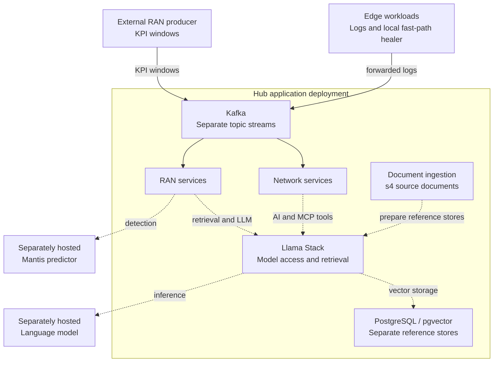
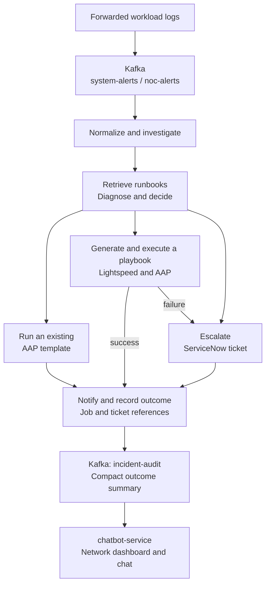
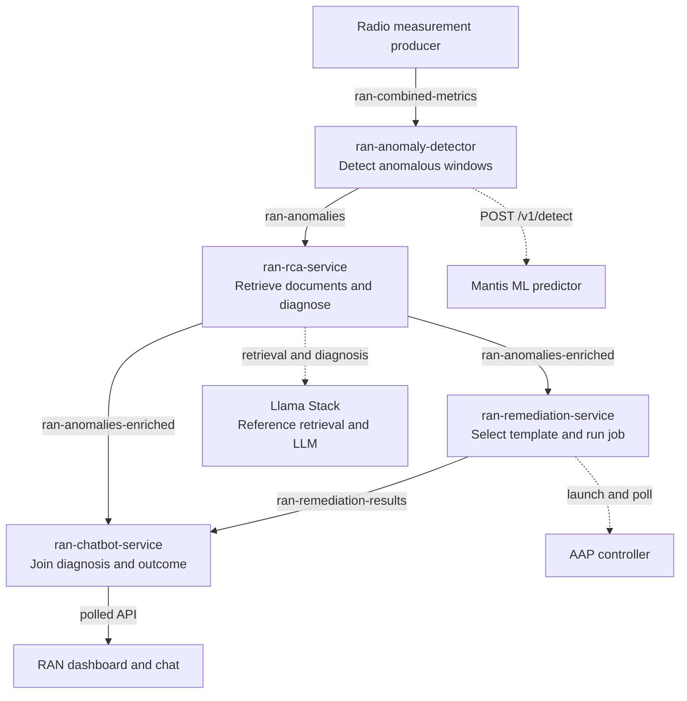

# Architecture Guide

This guide describes a deployment with all services and integrations configured and available.

The system provides two incident-response workflows on a shared OpenShift hub:

- **Network** investigates workload failures on OpenShift, retrieves runbooks, diagnoses the problem, and chooses automation or ServiceNow escalation.
- **RAN** (radio access network) detects unusual radio performance measurements with an ML predictor, uses reference documents and a language model to explain them, and selects an automation job.

The workflows have separate services, Kafka topics, and dashboards. They share infrastructure and model access, but process incidents independently. Dashboard navigation connects the two applications; there is no cross-workflow incident correlation.

For deployment instructions, follow the [main README](../README.md).

## System boundaries

The hub hosts the application services, Kafka, Llama Stack, document ingestion, and storage. Llama Stack provides language-model access, document retrieval, and the Network workflow's Model Context Protocol (MCP) tool gateway. The language model and RAN ML predictor are separately hosted endpoints; the hub chart does not deploy their inference workloads.

In these diagrams, solid arrows show event or processing flow; dashed arrows show supporting dependencies or API calls. The edge healer acts locally on workloads; RAN measurements come from a separate producer.

Ansible Automation Platform (AAP) executes remediation playbooks. ServiceNow records Network incidents that require escalation.

## Network: from workload alert to recorded outcome

`agent-service` owns the Network LangGraph workflow. Its Kafka consumer starts investigations directly; an Event-Driven Ansible rulebook is not required for this path. Alert ingestion and outcome publication use Kafka clients directly, independently of the available Kafka MCP tools.

1. **Ingest and identify.** The agent consumes `system-alerts` and `noc-alerts`, normalizing the message into workload, namespace, container, and edge-site context. ClusterLogForwarder sends selected application logs to hub Kafka. A direct `POST /remediate` endpoint can also invoke the workflow.
2. **Investigate.** The agent obtains pod status, then uses a bounded language-model tool loop to gather Kubernetes events, pod logs, and resource specifications. OpenShift MCP routes queries to the target cluster. Loki MCP tools provide aggregated log searches and recurring error patterns. Tool failures leave partial evidence available for diagnosis.
3. **Retrieve and diagnose.** The agent searches the `noc_runbooks` vector store through Llama Stack. It combines retrieved snippets with the alert and investigation evidence to produce a structured diagnosis: failure type, confidence, severity, evidence, and recommended actions.
4. **Choose and act.** Confidence and template-selection rules determine whether to launch an existing AAP template, attempt playbook generation, or escalate. A model-based match check can reject an unsuitable existing playbook. Network invokes AAP through MCP, passes the target workload/site context, and polls the job for completion. For existing-template jobs, retries are limited to eligible launch failures; a completed failed job or timeout is recorded, not automatically converted into a ServiceNow escalation.
5. **Escalate or record.** The escalation branch creates a ServiceNow incident with the diagnosis, original alert, and available failure details. The final nodes notify Slack and publish the outcome, duration, and job/ticket references to `incident-audit`.

**Ansible Lightspeed** generates a playbook from the diagnosis and evidence. The agent parses and sanitizes its YAML, commits it to Gitea through AAP MCP, synchronizes the AAP project, creates or updates a template, and launches and polls the job. Generation or execution failure routes to escalation.

Successful generation/execution results trigger an asynchronous, best-effort upload to `noc_runbooks`. Generated entries are not copied to s4, and rebuilding the vector store from the source corpus replaces those additions.

The Network dashboard's `chatbot-service` backend reads recent audit records, probes integrations, and obtains ServiceNow incident counts. Audit records contain compact outcome summaries, not the full diagnosis or investigation evidence. The frontend polls this backend for status and the incident timeline. Chat uses that operational context with the shared language model; it does not itself run the remediation graph.

See [Graph Nodes](graph-nodes.md) for the node reference.

## RAN: from measurements to diagnosis and automation

RAN separates detection, explanation, and action into three services. Its input is a complete TelecomTS-format KPI window: **128 timesteps across 18 measurement channels**, plus incident, zone, and application context. A measurement producer supplies this data to the detector through Kafka.

Labels between RAN services are Kafka topics. The two consumers of enriched anomalies use independent subscriptions: remediation can run while the dashboard displays the diagnosis.

1. **Detect.** `ran-anomaly-detector` consumes `ran-combined-metrics` and sends the KPI window to the separately hosted Mantis predictor. The supplied predictor encodes the measurements and applies a trained binary classifier, returning `normal` or `anomalous` with confidence. Only anomalous windows are published to `ran-anomalies`.
2. **Explain.** `ran-rca-service` searches `telco_oran_docs` using anomaly context and KPI summaries. Through Llama Stack, the language model examines measurement statistics and reference snippets, then returns a root-cause category, explanation, and recommended fix. These are published to `ran-anomalies-enriched`. Detection confidence belongs to the ML classifier, not to the language-model diagnosis. If diagnosis fails, the record continues with category `unknown` and empty explanation/fix fields.
3. **Act.** `ran-remediation-service` maps the root-cause category to a `ran-*` AAP template, passes the incident context, and calls the controller REST API directly. It polls the job, notifies Slack, and publishes the outcome to `ran-remediation-results`. Unknown categories use `ran-generic-remediation`. This workflow has no Network-style confidence gate, ServiceNow escalation, or Lightspeed branch.
4. **Display.** `ran-chatbot-service` buffers enriched anomalies and remediation results, joining them by `incident_id` for `/api/anomalies`. The frontend polls that API and shows diagnosis and completed/failed remediation status. Its grid groups anomalies by **zone and application**; green cells mean no buffered anomaly, not measured radio health. Chat uses recent diagnoses and job outcomes with the language model. Job success does not include a subsequent measurement-based check that radio service recovered.

See the component guides for [detection](telco-oran-anomaly-detection.md), [root-cause analysis](telco-oran-rca.md), and [remediation](telco-oran-remediation.md), and the [predictor guide](../model-serving/ran-ml-service/README.md) for model hosting.

## Shared services, documents, and state

**Document ingestion** prepares both reference collections. On startup, it syncs packaged Network runbooks and converted RAN reference documents into S3-compatible **s4** object storage. It then uploads and chunks that content through Llama Stack into separate pgvector-backed stores: `noc_runbooks` and `telco_oran_docs`. Llama Stack supplies the embedding provider and vector search; the language model receives retrieved text as context. Ingestion rebuilds each vector store from its source corpus. See the [ingestion component](../hub/ingestion-pipeline/README.md) and [RAG guide](autorag.md).

**Shared infrastructure does not merge workflows.** Both use the same Kafka broker, Llama Stack service, and PostgreSQL/pgvector instance. Both workflows send automation requests to AAP. Their deployments, consumers, reference collections, and event contracts remain separate. Network tools reach OpenShift, AAP, ServiceNow, Kafka, and Loki through MCP; RAN automation calls AAP directly.

**Dashboard navigation** uses links between the `hub-frontend` and `hub-ran-frontend` routes. Each frontend proxies API requests to its own chatbot backend. The links derive the sibling hostname from the default route names; they do not transfer incident context or combine incident lists. OpenShift authentication controls dashboard access.

| Information | Where it lives |
| --- | --- |
| Network alerts/outcomes and RAN measurements/diagnoses/outcomes | Their respective Kafka topics, subject to configured retention. Network outcomes use `incident-audit`; RAN outcomes use `ran-remediation-results`. |
| Reference documents and searchable chunks | s4 source objects and separate Llama Stack vector stores backed by PostgreSQL/pgvector. |
| In-flight workflow state | In-process LangGraph state. The graphs compile without a database checkpointer. PostgreSQL is not an incident-state store. |
| Dashboard and chat state | Recent records and conversation history in backend memory. RAN buffers reload a bounded recent history from Kafka on reconnect. |
| Automation definitions and execution records | AAP templates/jobs and, for Network Git-backed playbooks, Gitea. |
| Log storage and queries | Loki stores aggregated logs and provides queries through its MCP service. |

## Deployment topology and integration boundaries

The hub runs both incident-processing workflows and their shared infrastructure. Workload clusters provide logs and cluster evidence; a separate radio measurement producer supplies RAN input.

- **Single cluster:** Hub services and monitored workloads use separate namespaces on the same OpenShift cluster.
- **Hub and spokes:** The hub runs the processing services. Spoke clusters run workloads, the fast-path healer, and ClusterLogForwarder. Advanced Cluster Management (ACM) and GitOps manage spoke access and workload delivery. Logs reach hub Kafka through its external mutual-TLS listener; hub services use the internal listener. OpenShift MCP selects cluster credentials using the incident's edge-site identity.

The **edge fast-path healer** handles local Network remediation. Its watcher detects recent out-of-memory terminations or an unsafe memory limit on the target deployment and calls a local runner. The runner updates memory resources and rollout annotations, subject to a cooldown, without waiting for hub inference or AAP. Hub logic checks recent remediation annotations to avoid duplicate actions and suppresses forwarded-log feedback during cooldown. See the [healer guide](edge-fast-path-healer.md).

The language model and Mantis predictor serve inference through separate endpoints. AAP holds execution credentials, inventories, and job templates; Gitea stores Network playbooks. Network invokes automation through AAP MCP, while RAN calls the controller API directly using its `ran-*` templates. ServiceNow handles Network escalation, and Slack receives workflow notifications.

See the [topology guide](multi-cluster-deploy.md) for cluster setup and the [AAP integration guide](../hub/mcp-servers/mcp-aap/README.md) for controller configuration.
